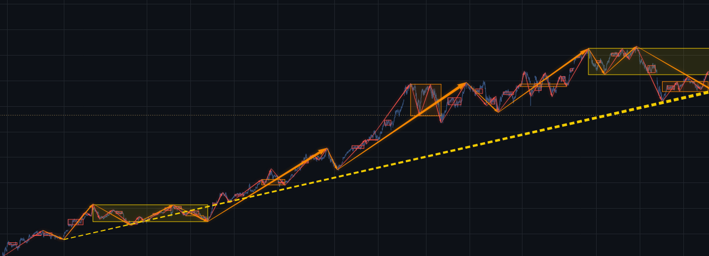

**级别不是你选出来的参数，是从走势里长出来的。**

大多数工具让你选周期：选 30 分钟，它给你 30 分钟的图。
但缠论里的"级别"从来不是这个意思——**低一级的走势构成高一级的段，
级别是一层层递归长出来的。**

缠析做的就是这件事。各级别可以逐级开关，你能亲眼看到
同一段行情在低、中、高三层下的形态，看几遍，"级别"这个概念就不再是书上的定义。

而在这之前，**笔和线段都不用你画**——K 线到线段、线段到走势与中枢，
引擎自动分解。省下数 K 线的力气，用在真正该琢磨的地方。

> 想先看看它长什么样：**[mychan.cn](https://mychan.cn)**

## 下载

版本：v0.2.12｜发布日期：2026-11-07

到 [Releases](../../releases) 取最新版。**装上就能用**，分解引擎随包附带，
不用另外配置任何东西。

> 点下表里的链接直接下载。（[Releases](../../releases) 页面里那一堆 `.zip` 和 `.sig`
> 是应用自动更新用的，不用管。）

| 你的系统 | 点击下载（v0.2.12） |
|---|---|
| Windows 10 及以上 | [chanxi_0.2.12_x64-setup.exe](https://gitee.com/doo8w/mychan/releases/download/v0.2.12/chanxi_0.2.12_x64-setup.exe) ｜ [GitHub 镜像](https://github.com/traddo/mychan/releases/download/v0.2.12/chanxi_0.2.12_x64-setup.exe) |
| macOS（2020 年后的 Mac，M1/M2/M3…） | [chanxi_0.2.12_aarch64.dmg](https://gitee.com/doo8w/mychan/releases/download/v0.2.12/chanxi_0.2.12_aarch64.dmg) ｜ [GitHub 镜像](https://github.com/traddo/mychan/releases/download/v0.2.12/chanxi_0.2.12_aarch64.dmg) |
| macOS（更早的 Intel Mac） | [chanxi_0.2.12_x64.dmg](https://gitee.com/doo8w/mychan/releases/download/v0.2.12/chanxi_0.2.12_x64.dmg) ｜ [GitHub 镜像](https://github.com/traddo/mychan/releases/download/v0.2.12/chanxi_0.2.12_x64.dmg) |
| Linux（Ubuntu / Debian 等） | [chanxi_0.2.12_amd64.deb](https://gitee.com/doo8w/mychan/releases/download/v0.2.12/chanxi_0.2.12_amd64.deb) ｜ [GitHub 镜像](https://github.com/traddo/mychan/releases/download/v0.2.12/chanxi_0.2.12_amd64.deb) |
| Linux（其他发行版，免安装） | [chanxi_0.2.12_amd64.AppImage](https://gitee.com/doo8w/mychan/releases/download/v0.2.12/chanxi_0.2.12_amd64.AppImage) ｜ [GitHub 镜像](https://github.com/traddo/mychan/releases/download/v0.2.12/chanxi_0.2.12_amd64.AppImage) |

国内用左边的链接（Gitee）更快；打不开时用右边的 GitHub 镜像。

**不确定自己是哪种 Mac？** 点左上角苹果图标 →「关于本机」，
写着「芯片 Apple M…」选 aarch64，写着「处理器 Intel」选 x64。

### 首次打开

- **Windows**：见下方「安全软件误报」一节
- **macOS**：**右键点击图标 →「打开」**（直接双击会被系统拦下）——安装包尚未做
  Apple 公证，不是软件本身有问题
- **Linux AppImage**：先 `chmod +x chanxi_*.AppImage`（AppImage 格式本身的要求）

### 安全软件误报

Windows 安装包未购买代码签名证书，可能遇到两种情况，都是误报：

一是弹出「Windows 已保护你的电脑」——点「更多信息」→「仍要运行」即可。

二是被 Defender 或杀毒软件当成威胁直接删除——到杀软的「保护历史记录」里恢复，
或先把安装包加入排除项，再安装。

安装包带有发布签名，可校验未被篡改。

## 怎么用

打开后左侧有三个视图，对应三种用法：

### 学习 —— 看别人怎么划的

打开精选行情片段，看分解好的结构。配合 `Ctrl+P` 渐进显示，
能看着走势与中枢随 K 线一根根推进而逐步长出来——**看到的时刻，就是当时真能判定的时刻**。

### 练习 —— 自己动手划

盲练：**线段作为已知条件给你**，走势和中枢自己画，画完对答案、自动打分。
——省掉的是画笔画线段的苦力活，要练的判断一样也不少。

练习时结构显示快捷键会被关掉，不能直接把答案调出来看。

### 复盘 —— 看自己关心的品种

> 原「自研」，0.2.0 起改名并重做了数据源设置。

导入你自己的行情数据，用同一套引擎做分解。支持三种来源：

- **通达信** —— 在「股票池」选择安装目录或 vipdoc，先下载 1 分钟线，再扫描、按代码或部分名称筛选并应用；个股按本地权息文件前复权。
- **MT4** —— 在复盘清单上方 **⚙** 的数据源设置中，选择 `history/<服务器名>` 目录，读取 1 分钟 `.hst` 历史数据。
- **自备 CSV** —— 在同一数据源设置中选择 CSV 文件夹，列名自动识别。

股票池可从顶栏「股票池设置」图标或复盘工具条打开。输入「万科」「茅台」「中证500」等名称片段就能过滤，不必输入全称；名称过滤忽略空格、全半角及大小写。

股票池默认每天本机时间 **17:30** 自动读取本机通达信文件，可关闭或改时间。请先在通达信里下载好行情。**缠析缩到托盘后仍会刷新，从托盘退出后才停止；完全退出期间不会刷新。**错过当天时间，下次启动约 1 分钟后补跑当天一轮。正在查看的股票本轮跳过，源文件变短时不自动覆盖本地历史。

复盘清单旁的 **⟳ 立即刷新** 会重读全部来源文件、重跑分解，选择和笔记保留；它仍按源文件整段替换，请确认源文件完整。MT4、CSV 不参加股票池定时刷新。

已有通达信股票升级后直接出现在股票池，不必重新导入。扫描结果会保存，重开面板或重启后打开面板不重扫；新增股票应用时仍需读取源目录。

以 **1 分钟**数据为基础。正式版股票池、MT4、CSV **共用合计 10 个品种**的额度，样例不占额度；邀请解锁规则不变。累计 10 位受邀人各自连续 5 个有效日打开「今日分解」并完成绘制确认后，解除这份数量限制；各人可错峰完成，已达标资格不因后续断日清零，自动刷新不计作奖励有效日。

行情文件、画线和笔记保存在本机。登录后会发送之后完成的正式练习最小结果，不补传历史练习；可关闭的使用情况统计只记导入、刷新等动作的成败与固定类别，不发送文件路径、品种代码、错误原文或行情内容。确认隐私说明 1.9 后，登录后发送的新意见会关联提交时的账号，账号邮箱仅供管理员处理对应意见使用，不会显示在公开页面或 App 的对话回包中；未登录时匿名发送，历史意见不补关联。尚未确认 1.9，或只更新功能模块且不支持该告知的旧版 App，继续匿名发送。完整范围见 App 的「设置 → 基础信息 → 隐私」。

数据较长时默认分析最近两年，界面会写明截取了哪一段。

> MT5 的历史数据格式未公开，暂不直接支持；MT5 用户可在终端里
> `View → Symbols → 选品种 → Bars → Export Bars` 导出 CSV，再走「自备 CSV」。

**完整操作说明见 [用户手册](docs/user-manual.md)** —— 界面、快捷键、图表操作、
标注工具、分享功能都在里面。

## 反馈

用着有问题、或者觉得哪里该改，欢迎提 issue，也可以直接来信：
**trad_do@hotmail.com**

每版改了什么见 [更新记录](CHANGELOG.md)。

## 更新方式说明

- 应用会提示 App 新版本，确认后可下载并安装；请先保存正在编辑的内容。
- 分解引擎和已有功能模块可分别在线更新；需要更新 App 时按应用提示操作。
- **股票池需要升级到 0.2.12 App 才有。**只更新旧版已有功能模块，不会增加这个入口。
- 还在使用 0.2.0 的 macOS / Linux 用户，若应用内更新装不上，请从本页下载安装包手动更新一次；Windows 按应用提示更新。
